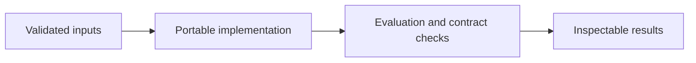

# Salary Regression and Model Diagnostics

**Feras Elghandour** · Technical case study

Explain the association between salary, experience, education, and job-title indicators while checking whether regression assumptions support the interpretation.

## Implementation

A portable OLS analysis that splits before feature selection and reports HC3 intervals and held-out errors.



## Completed study

The saved analysis uses 373 complete records and reports in-sample R² of 0.9145. Its exploratory holdout MAE is $9,584.29. The experience coefficient is $5,104.44 per year, conditional on the other retained predictors.

These historical figures describe the completed study. This refactored standalone implementation has separate validation and has not been used to recertify the historical benchmark. The public release contains the portable core and focused tests.

## Run locally

Python 3.11 or later.

```sh
python -m venv .venv
source .venv/bin/activate
python -m pip install -r requirements.txt
python smoke_test.py
python salary_model.py /path/to/salary_data.csv
```

Prepare your own inputs as described in [DATA.md](DATA.md). Tests use generated fixtures and do not need credentials or provider calls. [VALIDATION.md](VALIDATION.md) records their scope.

## Practical relevance and limitations

In the historical study, feature selection precedes the exploratory split, so its holdout is not an unbiased estimate of an isolated selection procedure. The current core fixes the order by selecting within the training partition. Observational associations, including the gender coefficient, are not causal effects or a justification for compensation decisions.

This edition makes the core behavior reusable and inspectable. Historical metrics and synthetic contract tests provide different kinds of evidence; neither establishes client deployment or commercial impact.
