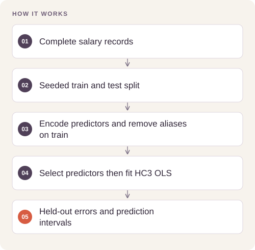

# Salary Regression and Model Diagnostics

Explain the association between salary, experience, education, and job-title indicators while checking whether regression assumptions support the interpretation.

## Implementation

A portable OLS analysis that splits before feature selection and reports HC3 intervals and held-out errors.




## Fit and reuse the regression

The training path exports selected predictors, fitted coefficients, robust intervals, source hash and held-out metrics. A separate point-prediction command reuses the frozen design.

[Commands, artifacts and benchmark scope](BENCHMARKS.md) · [Versioned profiles](reproduction.json)


## Try a small example

A small offline fixture exercises the public implementation. It demonstrates the behavior shown below; it does not replace the historical dataset, benchmark or production validation.

After the local setup below, run from the repository root:

```sh
python examples/quickstart.py
```

The [example source](examples/quickstart.py), [captured output](examples/expected-output.txt) and [execution record](examples/environment.json) keep this demonstration inspectable. Floating-point values may vary with library versions.

Observed output from this run:

```text
{
  "train_rows": 96,
  "test_rows": 24,
  "selected_predictors": [
    "const",
    "experience"
  ],
  "holdout_mae": 863.8451613776101,
  "holdout_rmse": 1016.3143540073916,
  "holdout_r2": 0.9979452186964739,
  "coefficients": {
    "const": 30147.380029479904,
    "experience": 3994.68136462966
  },
  "hc3_intervals": {
    "const": [
      29689.71169791474,
      30605.04836104507
    ],
    "experience": [
      3956.1754700883175,
      4033.1872591710026
    ]
  }
}
```

## Completed study

The saved analysis uses 373 complete records and reports in-sample R² of 0.9145. Its exploratory holdout MAE is $9,584.29. The experience coefficient is $5,104.44 per year, conditional on the other retained predictors.

These historical figures describe the completed study. This refactored standalone implementation has separate validation and has not been used to recertify the historical benchmark. The public release contains the portable core and focused tests.

## Run locally

Python 3.11 or later.

```sh
python -m venv .venv
source .venv/bin/activate
python -m pip install -r requirements.txt
python smoke_test.py
python salary_model.py /path/to/salary_data.csv
```

Prepare your own inputs as described in [DATA.md](DATA.md). Tests use generated fixtures and do not need credentials or provider calls. [VALIDATION.md](VALIDATION.md) records their scope.

## Practical relevance and limitations

In the historical study, feature selection precedes the exploratory split, so its holdout is not an unbiased estimate of an isolated selection procedure. The current core fixes the order by selecting within the training partition. Observational associations, including the gender coefficient, are not causal effects or a justification for compensation decisions.

## Reuse

The original contributions listed in [LICENSING.md](LICENSING.md) are available under [MIT](LICENSE). This scoped grant preserves upstream notices and separate dataset, simulator, notebook and checkpoint terms.
